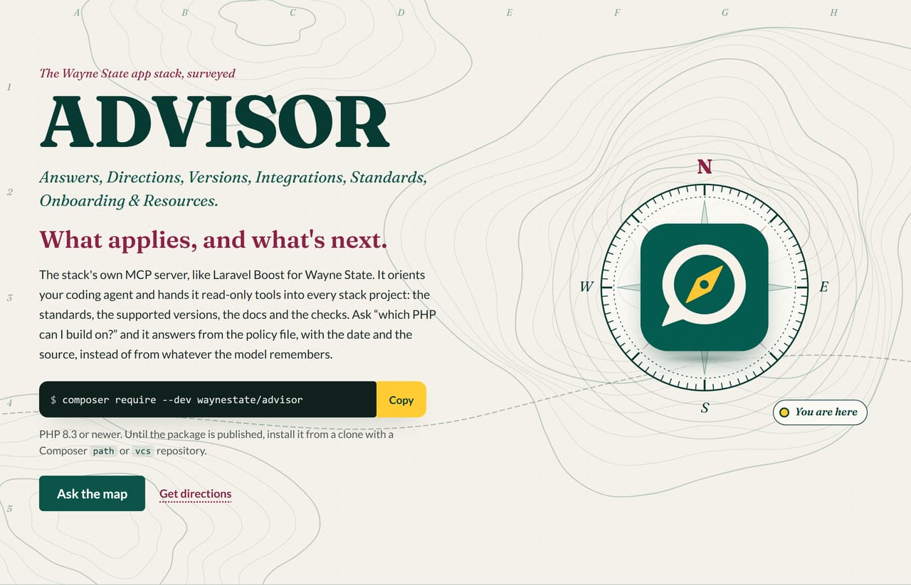
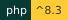
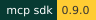
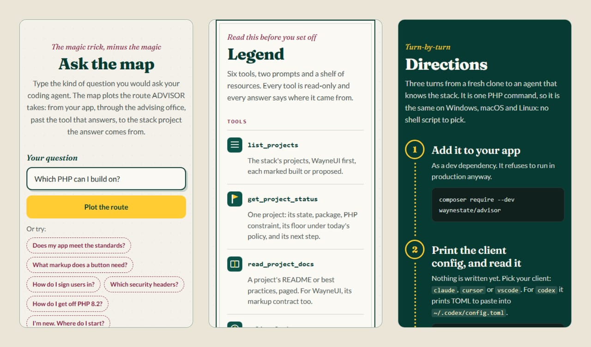
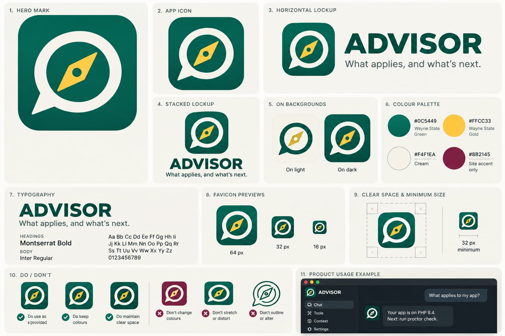

<div align="center">
  <a href="site/index.html"></a>
</div>

# ADVISOR

<div align="center">
  
  
  
  <a href="https://github.com/waynestate/advisor/actions/workflows/ci.yml"></a>
</div>

<div align="center"><b>What applies, and what's next.</b></div>

Front page: [`site/index.html`](site/index.html), a static field map of the stack (open it in a browser).

Checks: `composer ci` (the same command runs on GitLab and GitHub). The badge addresses above are placeholders until the repositories exist.

> Every WSU student has an advisor. Now every WSU app does too, and this one answers email.

ADVISOR is WELD's own MCP server, like Laravel Boost for WSU. It orients a developer who is new to the stack and gives
their coding agent read-only tools into it: the CREED standards and policy, PROCTOR results, the upgrade path,
the WayneUI markup contract, SESAME and HELMET guidance, and the parts list. Ask it "which PHP can I build on?" and it
answers from the policy file, with the date and the source, instead of from whatever the model remembers.

It is read-only in 0.1. It cannot write a file, run a shell command, or call out to the network. The one thing it can
start is the app's own `vendor/bin/proctor`, with a fixed argument shape.

## Where it sits in WELD

WELD is the Wayne State application stack: Wired, Everything, Linked, Deployed. ADVISOR is the part that talks to your
coding agent.

<!-- stack-parts:start -->

<!-- generated by advisor stack-parts; edit ADVISOR's projects.seed.json -->

| Part | What it is |
|---|---|
| **WayneUI** | interface (project 0) |
| **CREED** | version policy and written standards |
| **PROCTOR** | checks an app |
| **SESAME** | sign-in inside the app |
| **HELMET** | runtime baseline |
| **Sourdough** | starter |
| **PREFLIGHT** | CI components |
| **Pinstripe** | coding standard |
| **BOOSTER** | upgrades |
| **ROLLCALL** | fleet census |
| **DRAWBRIDGE** | sign-in gateway |
| **SQUIRE** | deploy kit |
| **ADVISOR** | MCP server |
| **WELD** | the stack's name and its reference app |

<!-- stack-parts:end -->

ADVISOR serves a bundled copy of what these projects publish (see "Served content"), so it works offline, and it does
not replace Laravel Boost. Boost knows Laravel; ADVISOR knows WSU. Run both.

## Install

PHP 8.3 or newer (8.3, 8.4 and 8.5 are tested). Add it to the app as a dev dependency:

```
composer require --dev waynestate/advisor
```

The command is then `php vendor/bin/advisor`. This works the same on Windows, macOS and Linux, because it is one PHP
command and not a shell script.

Until the package is published, install it from a clone of the repository with a Composer `path` or `vcs` repository.

## Quick start

1. Print the config your MCP client needs, and read it:

   ```
   php vendor/bin/advisor install --client=claude
   ```

2. Write it into the project when you are happy with it:

   ```
   php vendor/bin/advisor install --client=claude --write
   ```

3. Open the project in your client and approve the `advisor` server by name when it asks.

The command it registers is always the same fixed string, `php vendor/bin/advisor mcp`, with `ADVISOR_ENABLED=1` in
its environment. Clients: `claude` (`.mcp.json`), `warriorgpt` (`.mcp.json`), `cursor` (`.cursor/mcp.json`), `vscode`
(`.vscode/mcp.json`) and `codex` (TOML, printed only; paste it into `~/.codex/config.toml`).

`install` never replaces a different existing `advisor` entry unless you pass `--force`, keeps your other servers, and
warns when the file is not in `.gitignore`. A client config starts a program on whoever opens the project, so do not
commit a generated one; this repository ignores `.mcp.json` for that reason.

Run the client from the folder that holds `vendor/`. If it starts somewhere else, set `ADVISOR_PROJECT_ROOT`.

### Laravel apps

ADVISOR also ships a Laravel adapter on `laravel/mcp`, auto-discovered by the service provider. With it, the same
server runs as `php artisan mcp:start advisor`, beside Boost. Publish the config if you want it in the app:

```
php artisan vendor:publish --tag=advisor-config
```

Settings come from the same `ADVISOR_*` variables, read through `config/advisor.php`. The same rules apply: off unless
`ADVISOR_ENABLED` is set, and never in production.

## What it offers

Tools (all read-only; each says where its answer came from):

| Tool | Does |
|---|---|
| `list_projects` | The stack's projects, WayneUI first, with built or proposed state. |
| `get_project_status` | One project: state, package, PHP constraint, its floor under today's policy, next step. |
| `read_project_docs` | A project's README, best practices, or (WayneUI only) markup contract, paged. |
| `policy_lookup` | Support state for a runtime or tool (and an optional version) from CREED, as of today. |
| `list_stack_rules` | CREED handbook rules, each with its file and line, filtered by app permutation and chapter. |
| `run_proctor_check` | Runs the app's own `vendor/bin/proctor check` against the bundled policy and returns the findings. |

Resources: `advisor://policy` and one `advisor://creed/<chapter>` per handbook chapter.
Prompts: `orient_me` and `plan_upgrade`.

Here is what that looks like when you ask. Each numbered control point is one of the tools above, with the arguments the
front page's own route table sends:

<div align="center"></div>
<div align="center"><sub>Ask the map: three questions, three routes. Every control point is a real ADVISOR tool or prompt, and the whole trip is read-only.</sub></div>

<details>
<summary><b>Phone-sized field notes</b>: the front page's ask box, legend and directions</summary>
<br>
<div align="center"></div>
</details>

Everything ADVISOR returns is labelled as reference data. PROCTOR in CI, not ADVISOR, decides pass or fail.

## Configuration

ADVISOR reads the process environment only, never a file. The placeholders are in `.env.example`.

| Variable | Default | Meaning |
|---|---|---|
| `ADVISOR_ENABLED` | off | Must be `1` or `true`, or the server refuses to start. `advisor install` sets it in the client config. |
| `ADVISOR_ENV` | `APP_ENV`, then `local` | `production` or `prod` always refuses to start. |
| `ADVISOR_PROJECT_ROOT` | the working directory | The folder `run_proctor_check` may look inside. Paths outside it are refused. |
| `ADVISOR_READ_ONLY` | on | Set to `0` or `false` to allow tools that write. None exist in 0.1. Read-only wins over `ADVISOR_GROUPS`. |
| `ADVISOR_GROUPS` | all | Comma list of tool groups to offer (`stack`, `proctor`). |
| `ADVISOR_PROCTOR_TIMEOUT` | `120` | Seconds before a PROCTOR run is stopped (1 to 900). |
| `ADVISOR_MAX_CHARS` | `20000` | Largest piece of text one doc call returns (1000 to 45000). |
| `ADVISOR_AUDIT_LOG` | off | A file for a one-line-per-call audit log: time, tool, a hash of the arguments, outcome, duration. Arguments are hashed, never written. |
| `ADVISOR_LOG_LEVEL` | `warning` | Log level on stderr (`debug` to `emergency`). |
| `ADVISOR_STACK_DIR` | none | Folder holding the sibling stack repos; used only by `content:generate`. |
| `ADVISOR_PRIVATE_DENYLIST` | none | A file (kept outside the repo) with private strings to strip from the bundle; used by `content:generate` and the public-posture test. See "Releasing". |
| `ADVISOR_MODULES_FILE` | none | An extra module manifest (see "Modules"). |

A bad value stops the server with a message on stderr. It does not guess.

## Commands

```
php vendor/bin/advisor mcp                          # serve over stdio (your client starts this)
php vendor/bin/advisor install [--client=claude] [--write] [--force] [--path=.]
php vendor/bin/advisor content:verify               # check the bundled content against its manifest
php vendor/bin/advisor content:generate [--sources=<dir>] [--check]
php vendor/bin/advisor stack-parts [--write=<readme>] [--check=<readme>]
php vendor/bin/advisor doctor [--json]              # check the install when the server does not show up
```

Stdout carries only protocol messages. Logs, warnings and stray output go to stderr, so a client never sees garbage.

## When it doesn't show up

You added the config, opened the project, and the `advisor` server is not in the list. Run:

```
php vendor/bin/advisor doctor
```

It checks the four things that keep a server from appearing, in plain words, and changes nothing:

- **php** — the PHP on your machine satisfies ADVISOR's own `composer.json` (8.3 or newer).
- **content** — the bundled `data/` still matches its manifest.
- **client:claude**, **client:warriorgpt**, **client:cursor**, **client:vscode** — each client's MCP config: is the file there, does it have the `advisor` entry, and is the script it points at in the project? A missing file is a warning, not a failure — you only need the one client you use.
- **mcp** — the server actually starts: doctor boots it in-process and asks for its tools.

A `fail` is something to fix; a `warn` is something you may not care about. The exit code is `0` when nothing failed and `1` when something did; `--json` prints the findings as JSON.

The advisor will see you now.

## Served content

The handbook, policy, project docs and WayneUI contract in `data/` are generated from the sibling stack repositories by
`content:generate` and verified at start-up against `data/manifest.json` (a SHA-256 for every file). If a file does not
match, the server refuses to start rather than serve it. Files are cleaned on the way in: line endings are normalised
and invisible characters (the TAG block, zero-width and bidirectional controls) are stripped.

To refresh it, with the stack repos checked out side by side:

```
php vendor/bin/advisor content:generate --sources=/path/to/stack
php vendor/bin/advisor content:generate --sources=/path/to/stack --check   # exits 1 on drift
```

CI cannot see the sibling repositories, so `composer ci` runs `content:verify`, which needs none of them.

## Releasing

ADVISOR is a public repository, so the bundle must not carry internal names. The public-posture test always checks
generic shapes (ADR numbers, open-question numbers, design-doc paths, the coordination repo). Private strings
(hostnames, people) are loaded from the file named by `ADVISOR_PRIVATE_DENYLIST` and checked only when the file is
present.

To release:

1. Set `ADVISOR_PRIVATE_DENYLIST` to a file kept outside the repository (one literal or `regex:` pattern per line,
   `#` comments).
2. In GitLab CI, the file comes from a masked file-type CI variable.
3. Regenerate the bundle with the file present: `php vendor/bin/advisor content:generate --sources=/path/to/stack`.
4. Run `composer ci` to confirm the public-posture test passes.

The file is never committed. The bundle is regenerated with the file present before every release.

## Modules

Each stack project can later ship its own ADVISOR tools. Modules load only from a manifest (`modules.json`), only from
the `Waynestate\` namespace, and only if they implement the `Module` interface. Nothing scans a folder.

## Running the checks

```
composer ci
```

That runs `composer validate --strict`, `content:verify`, PHPUnit, Pint, PHPStan (level 8, Pinstripe settings) and
`composer audit`. No PHP on your machine? Use Docker:

```
docker run --rm -v "${PWD}:/app" -w /app composer:2.10.3 sh -c "composer install --no-interaction && composer ci"
```

Tests drive the real SDK server in-process with a small MCP client, snapshot `tools/list`, and start
`bin/advisor mcp` as a subprocess to prove stdout stays clean. To accept an intended change to the tool list, run
`ADVISOR_UPDATE_SNAPSHOTS=1 vendor/bin/phpunit`, then review and commit the diff.

## Safety, in short

- Off unless enabled; refuses production; refuses to start on a bad setting or a content file that fails its hash.
- Read-only by default; no tool takes a command, a URL or a free path.
- Every result is cleaned of invisible characters and labelled as data; secrets in PROCTOR output are redacted.
- `run_proctor_check` runs one fixed program with an argument array and an allowlisted environment, never a shell.
- No network calls, and no model calls, from ADVISOR itself.

See `BEST_PRACTICES.md`, and `OPEN_QUESTIONS.md` for what is decided, assumed and not yet built.

## Why "ADVISOR"

Because registration is open, the advisor will see you now, and unlike the real one it knows which PHP version you are
allowed to be on. A little Creed energy too: it will tell you who you are, in `composer.json`, whether you like it or not.

<details>
<summary><b>The brand board</b>: the mark, lockups, palette and type</summary>
<br>
<div align="center"></div>
</details>

## License

MIT. Copyright Wayne State University.

<div align="center"><b>Everyone on the sheet</b><br><sub>WayneUI and the stack. ADVISOR is the one with office hours.</sub></div>

<div align="center">
  <a href="https://github.com/waynestate/wayne-ui" title="WayneUI"></a>
  <a href="https://github.com/waynestate/creed" title="CREED"></a>
  <a href="https://github.com/waynestate/proctor" title="PROCTOR"></a>
  <a href="https://github.com/waynestate/sesame" title="SESAME"></a>
  <a href="https://github.com/waynestate/helmet" title="HELMET"></a>
  <a href="https://github.com/waynestate/sourdough" title="Sourdough"></a>
  <a href="https://github.com/waynestate/squire" title="SQUIRE"></a>
  <a href="https://github.com/waynestate/preflight" title="PREFLIGHT"></a>
  <a href="https://github.com/waynestate/pinstripe" title="Pinstripe"></a>
  <a href="https://github.com/waynestate/booster" title="BOOSTER"></a>
  <a href="https://github.com/waynestate/rollcall" title="ROLLCALL"></a>
  <a href="https://github.com/waynestate/drawbridge" title="DRAWBRIDGE"></a>
  <a href="https://github.com/waynestate/advisor" title="ADVISOR"></a>
  <a href="https://github.com/waynestate/weld" title="WELD"></a>
</div>

<div align="center"><sub>Images are regenerated from the front page by <a href="scripts/readme-art/README.md"><code>scripts/readme-art</code></a>. No appointment necessary.</sub></div>
